<div align="center">


# Clean TV — مدير الشاشات

**One identity across your TV, car and phone — built for Arabic-speaking users.**
**شاشاتك كلها بيد وحدة: تلفزيون، سيارة، وموبايل بهوية واحدة.**

 

[English](#english) · [العربية](#العربية)

</div>

<p align="center">
  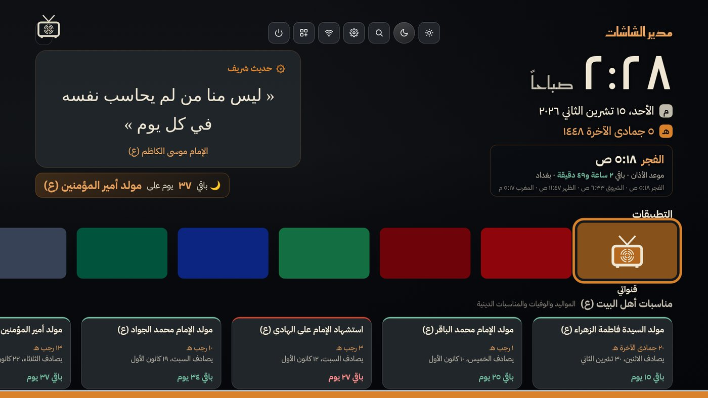
</p>

---

## English

**Clean TV** (branded in Arabic as *Screen Manager / مدير الشاشات*) is an open-source ecosystem of Android apps that replaces cluttered, ad-heavy stock TV home screens with a clean, RTL-first interface. It covers the TV and set-top box, the car screen, and the phone, all sharing the same colors, fonts and corner shapes.

The visual identity is inspired by Baghdad's technical history: the first Arab TV broadcast from Baghdad in 1956, and the round city with its four gates, placed inside a screen-shaped logo.

### Why it exists

Most TV launchers are built for English and left-to-right layouts. Arabic users end up with broken RTL, no Hijri date, no prayer times, no Arabic live-score bar, and free Arabic channels scattered across different apps. Clean TV fills that gap with one project that handles all of it and works on TV, car and mobile.

### Apps in this repository

| App | Folder | Package | What it does |
|---|---|---|---|
| **TV Launcher** (Screen Manager UI) | [`CleanTV/`](CleanTV) | `com.cleantv.launcher` | Home screen for Android TV, boxes and the car, including the built-in *Qanawati* free channels |
| **Screen Manager (Studio)** | [`Studio/`](Studio) | `com.moamal.studio` | Phone app to clean up, design and live-preview the TV interface, then export it with one tap |
| **Hawaa'i (Remote)** | [`Remote/`](Remote) | `com.cleantv.remote` | Full phone remote that finds the TV on its own |
| **Screen Manager Auto** | [`AutoApp/`](AutoApp) | `com.msm.auto` | Custom interface for Android Auto screens |
| **Qanawati Mobile** | [`Mobile/`](Mobile) | `com.cleantv.mobile` | Free channels, movies and series on the phone, with the same look as the TV |
| **Mafia** | [`Mafia/`](Mafia) | n/a (PWA) | Arabic RTL party game, online and offline, Node.js + SQLite + WebSocket |
| **Orders** | [`Orders/`](Orders) | n/a (PWA) | Small admin web tool (PDF/Excel handling) |
| **Website** | [`index.html`](index.html) | n/a | Landing page, downloads and gallery |

### Features

**TV / box / car launcher**
- Full interface with clock, Hijri and Gregorian dates, large readable app tiles, and full remote-control navigation
- Layouts styled after major TV brands: Samsung, LG, Hisense, Google TV, Fire TV, Roku, Xiaomi
- Live Arabic match ticker, and you choose which teams appear
- Prayer times, occasions, and a verse/hadith card
- Daily wallpapers, screensaver and news
- Kids mode and app lock
- Car interface with 14 designs and an editable screensaver

**Qanawati (free channels)**
- 190+ free-to-air channels from their official streams, with logos and categories: news, sports, MBC free bundle, movies, documentaries, kids
- Add your own licensed channels through an M3U list or YouTube link
- Info panel with channel logo and quality, and channel switching with remote arrows
- Mobile version adds movies and series from your own provider or list, favorites, continue watching, and a night-calm mode

**Phone apps**
- Live preview of every change before exporting
- Fast screen mirroring from phone to TV, connect over Wi-Fi or cable
- Remote with touchpad, arrows, volume, app launching, text input and search
- Change themes and wallpapers and send your own photos to the TV

### Screenshots

<table>
  <tr>
    <td align="center"><br><sub>TV home</sub></td>
    <td align="center">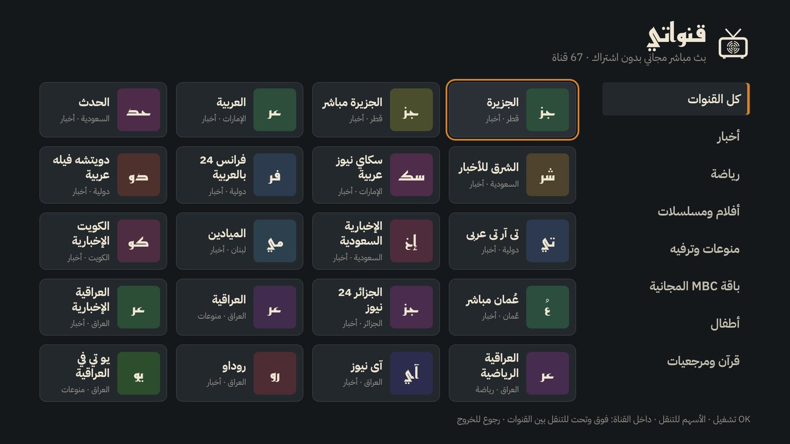<br><sub>Qanawati channels</sub></td>
  </tr>
  <tr>
    <td align="center">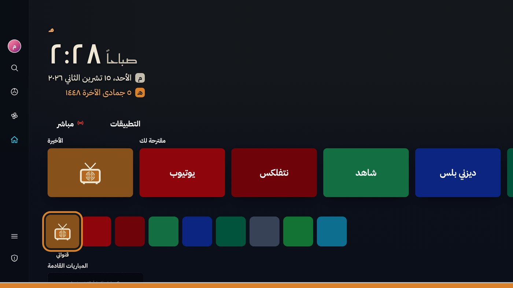<br><sub>Brand-style layout (Samsung)</sub></td>
    <td align="center">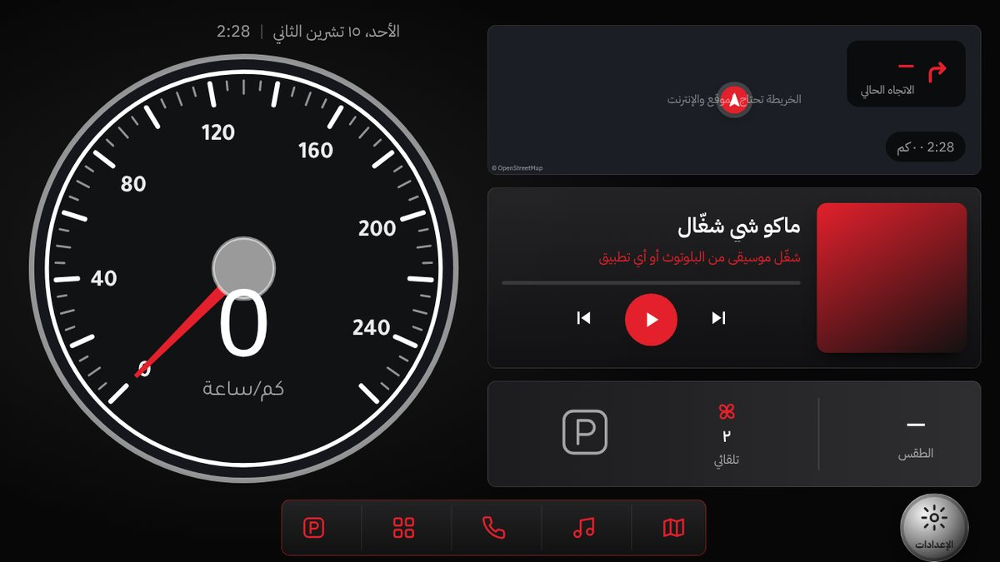<br><sub>Car interface</sub></td>
  </tr>
</table>

<table>
  <tr>
    <td align="center">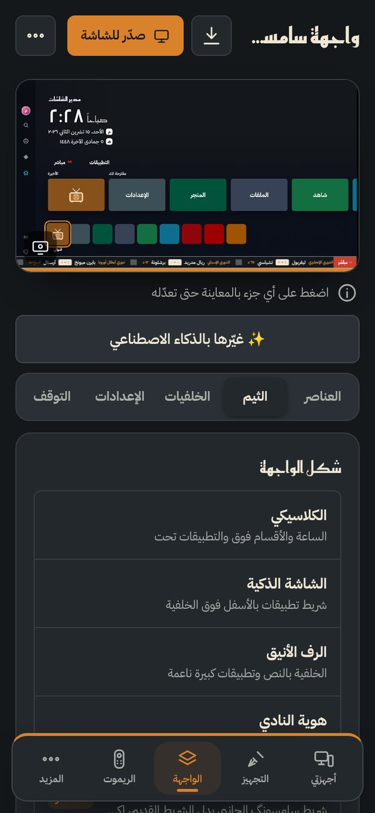<br><sub>Studio: design</sub></td>
    <td align="center">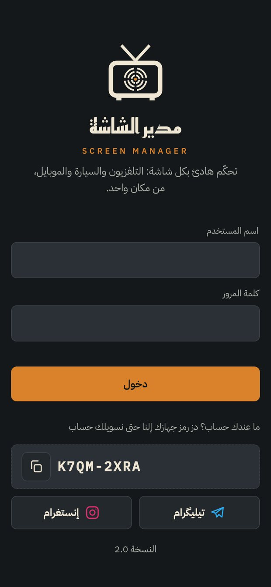<br><sub>Studio: connect</sub></td>
    <td align="center">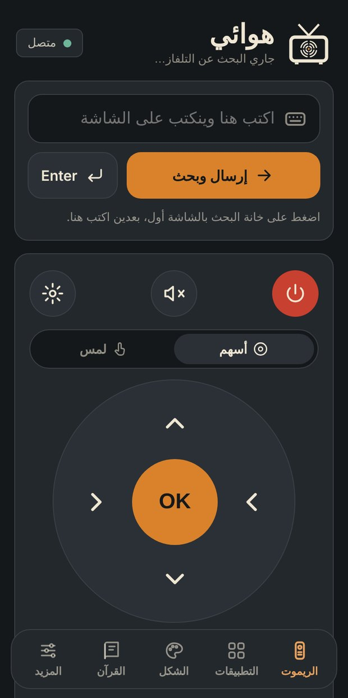<br><sub>Remote</sub></td>
    <td align="center">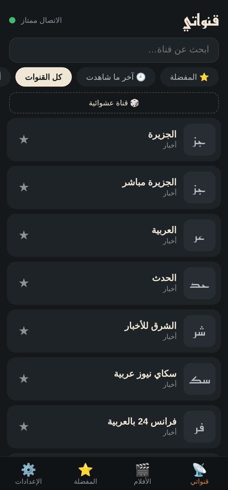<br><sub>Qanawati Mobile</sub></td>
  </tr>
  <tr>
    <td align="center">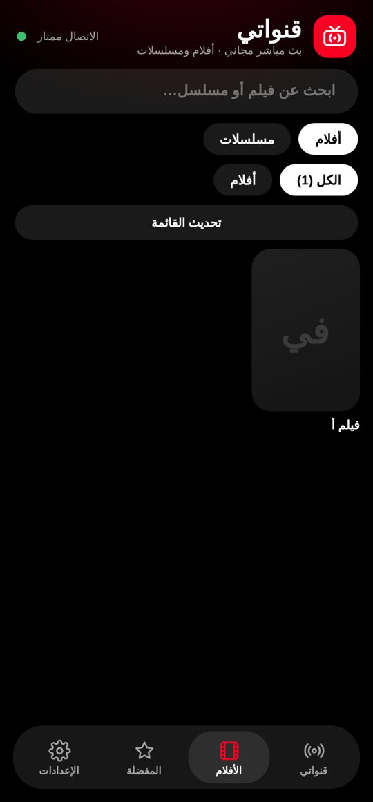<br><sub>Movies and series</sub></td>
    <td align="center">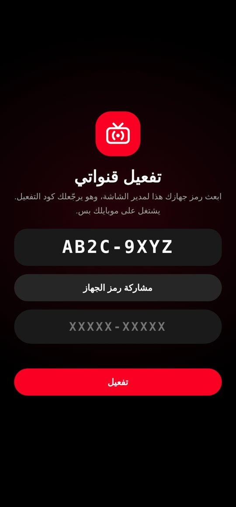<br><sub>Activation</sub></td>
    <td align="center">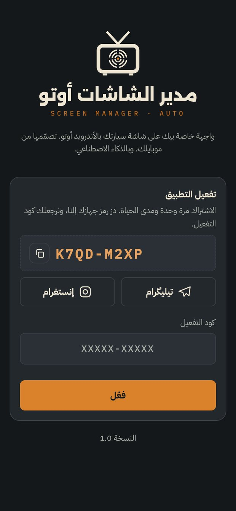<br><sub>Auto: phone</sub></td>
    <td align="center">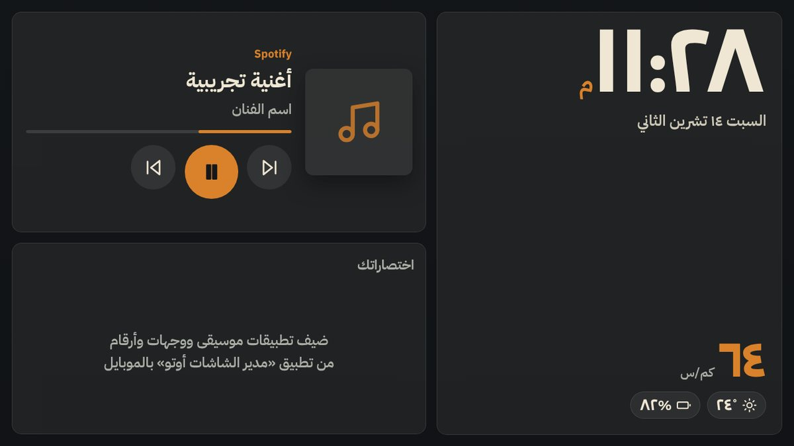<br><sub>Auto: car screen</sub></td>
  </tr>
</table>

### Theme gallery

[`gallery/`](gallery) holds ready-made launcher themes (preview image + JSON each): Calm Night, Neon Gamer, Royal Gold, Desert, Onyx, Glass, Turquoise, Apple Classic, Faith & Family, Kids, Sports, Ultra Minimal. `gallery/index.json` is the catalog the app reads, and `gallery/pack.zip` bundles them all. To add a theme, drop in a `.jpg` + `.json` and add an entry to `index.json`.

### Get started

1. **Download** the APKs from the [Releases](../../releases) page or the project website. If Android says "unknown source", allow installation from the browser for this one time.
2. **Connect your screen:** enable *USB/Wireless debugging* on the TV; the phone app finds it on Wi-Fi, or connect with a cable.
3. **Design and control:** design the interface with live preview, control the TV from the Remote app, and open Qanawati.

### Build from source

Requirements: JDK 17, Gradle 8.7, Android SDK (compileSdk 34).

```bash
# Each Android app is a standalone Gradle project
cd CleanTV && gradle assembleDebug --no-daemon     # TV launcher
cd Studio  && gradle assembleDebug --no-daemon     # Screen Manager (phone)
cd Remote  && gradle assembleDebug --no-daemon     # Remote
cd Mobile  && gradle assembleDebug --no-daemon     # Qanawati Mobile
cd AutoApp && gradle assembleDebug --no-daemon     # Android Auto
```

APKs are produced in `app/build/outputs/apk/debug/`. GitHub Actions ([`build.yml`](build.yml)) builds the TV launcher and publishes it to Releases on each push.

| App | minSdk | targetSdk | Version |
|---|---|---|---|
| TV Launcher | 24 | 34 | 6.0 |
| Studio | 26 | n/a | 6.0 |
| Remote | 26 | 34 | 5.0 |
| Auto | 26 | n/a | 5.0 |
| Mobile | 24 | 34 | 2.0 |

**Tests and tooling**

```bash
node tests/live.test.js     # channel/live logic
node tests/smart.test.js    # smart link detection
node tests/vod.test.js      # movies and series parsing

cd Mafia/server && npm install && npm test    # Mafia engine + WebSocket integration (Node 22.13+)
```

| Path | Purpose |
|---|---|
| `tools/build_channels.py`, `fetch_logos.py`, `channel_logos.json` | Build the channel list and fetch logos |
| `tools/brand/` | Generate app icons from the logo mark |
| `tools/site/build_site.py` | Build the website |
| `tools/widgets/` | Home-screen widget generator and manifests |
| `tools/perf/latency.js` | Mirroring latency measurement |

### Repository layout

```
CleanTV/   TV launcher            Studio/    Screen Manager (phone)
Remote/    Phone remote           AutoApp/   Android Auto
Mobile/    Qanawati Mobile        Mafia/     Party game (PWA + server)
Orders/    Admin web tool         widgets/   Home-screen widgets
gallery/   Theme catalog          img/       Screenshots and logo mark
tools/     Build and asset tools  tests/     Node tests
index.html Project website
```

### Contributing

Contributions are welcome: bug reports, Arabic/English localization, new themes for the gallery, device-compatibility reports (brand + model + Android version), and performance fixes for low-end TV hardware. Open an issue first for larger changes. See [CONTRIBUTING.md](CONTRIBUTING.md).

### Contact

Telegram: **@KMK3993** · Instagram: **@HN_45Y**

### License

Released under the [MIT License](LICENSE). Bundled third-party libraries keep their own licenses (see `Orders/pdfjs.LICENSE.txt` and `Orders/xlsx.LICENSE.txt`). Channel names, logos and TV-brand names belong to their respective owners and are used only to identify them.

---

## العربية

<p align="center"></p>

**مدير الشاشات (Clean TV)** منظومة تطبيقات أندرويد مفتوحة المصدر تستبدل واجهة التلفزيون الافتراضية المزدحمة بالإعلانات بواجهة نظيفة تدعم العربية من اليمين لليسار. تغطي التلفزيون والبوكس والسيارة والموبايل، كلها بنفس الألوان والخطوط والزوايا.

الهوية مستوحاة من تاريخ بغداد التقني: أول بث تلفزيوني عربي من بغداد عام ١٩٥٦، وشكل المدينة المدوّرة بأسوارها وبواباتها الأربع داخل شاشة الشعار.

### ليش المشروع

أغلب لانشرات التلفزيون مصممة للإنجليزي ولليسار لليمين. المستخدم العربي يلگى RTL مكسور، وما كو تاريخ هجري ولا مواقيت أذان ولا شريط مباريات عربي، والقنوات المجانية موزعة على تطبيقات مختلفة. مدير الشاشات يجمع كل هذا بمشروع واحد على التلفزيون والسيارة والموبايل.

### التطبيقات

| التطبيق | المجلد | الوصف |
|---|---|---|
| **واجهة مدير الشاشات** | `CleanTV/` | واجهة للتلفزيون والبوكس والسيارة، فيها قنواتي |
| **مدير الشاشة (ستوديو)** | `Studio/` | تنظّف الشاشة وتصمم الواجهة بمعاينة حية وتصدّرها بضغطة |
| **هوائي (الريموت)** | `Remote/` | ريموت كامل بالموبايل، يلگى التلفزيون وحده |
| **مدير الشاشات أوتو** | `AutoApp/` | واجهة خاصة لشاشة أندرويد أوتو |
| **قنواتي موبايل** | `Mobile/` | القنوات والأفلام والمسلسلات بالموبايل |
| **مافيا** | `Mafia/` | لعبة جماعية عربية أونلاين وأوفلاين |
| **الأوامر الإدارية** | `Orders/` | أداة ويب إدارية صغيرة |

### المميزات

- **واجهات حسب الشركة:** سامسونگ، إل جي، هايسنس، گوگل TV، فاير TV، روكو، شاومي
- **شريط مباريات مباشرة بالعربي** وتختار الفرق اللي تظهر
- **ساعة وتاريخ هجري وميلادي**، مواقيت الأذان والمناسبات، ومربع آية وحديث
- **قنواتي:** أكثر من 190 قناة مجانية من بثها الرسمي بشعارات وأقسام، وتضيف قنواتك المرخّصة من قائمة M3U أو رابط يوتيوب
- **واجهة سيارة** بـ 14 تصميم وشاشة توقف قابلة للتعديل
- **وضع الأطفال** وقفل التطبيقات
- **معاينة حية** لكل تعديل قبل التصدير
- **عرض شاشة الموبايل على التلفزيون** بسرعة وبدون تأخير
- **ريموت** بلوحة لمس وأسهم وصوت وفتح تطبيقات وكتابة نص
- **وضع الهدوء الليلي** بقنواتي موبايل: الصوت ينزل والترجمة تكبر بعد ساعة تحددها

### الصور

<table>
  <tr>
    <td align="center"><br><sub>واجهة التلفزيون</sub></td>
    <td align="center">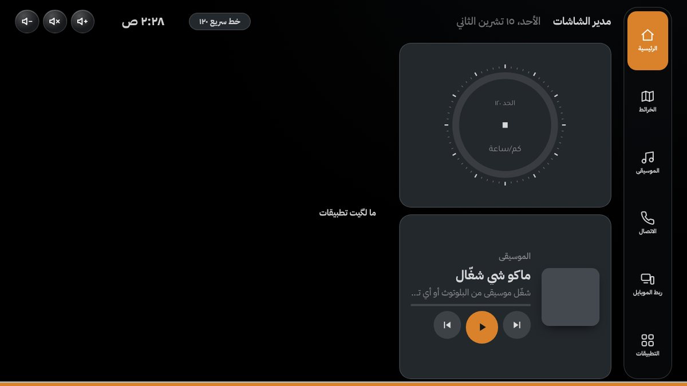<br><sub>هوية السيارة</sub></td>
  </tr>
</table>

### شلون تبدي

1. **نزّل التطبيقات** من صفحة [الإصدارات](../../releases). إذا الموبايل كال «التطبيق من مصدر غير معروف»، اسمح بالتثبيت من المتصفح بس لهذي المرة.
2. **اربط شاشتك:** شغّل «تصحيح الأخطاء» بالشاشة، والتطبيق يلگاها على الواي فاي أو اربطها بالكيبل.
3. **صمّم وتحكّم:** صمّم الواجهة وشوف التعديل قدامك، وتحكّم بالشاشة من هوائي، وشغّل قنواتي.

### البناء من المصدر

المتطلبات: JDK 17 وGradle 8.7 وAndroid SDK. كل تطبيق مشروع Gradle مستقل:

```bash
cd CleanTV && gradle assembleDebug --no-daemon
```

الاختبارات: `node tests/live.test.js` و`smart.test.js` و`vod.test.js`، ولعبة مافيا: `cd Mafia/server && npm install && npm test`.

### المساهمة

مرحب بأي مساهمة: تبليغ عن أخطاء، ترجمة، ثيمات جديدة بمجلد `gallery/`، وتقارير توافق الأجهزة (الشركة والموديل وإصدار أندرويد)، وتحسين الأداء على الأجهزة الضعيفة.

### التواصل

تيليگرام: **@KMK3993** · إنستغرام: **@HN_45Y**

### الرخصة

مرخّص تحت [رخصة MIT](LICENSE). المكتبات الخارجية المرفقة تبقى برخصها الأصلية. أسماء وشعارات القنوات والشركات تعود لأصحابها وتُستخدم للتعريف فقط.
